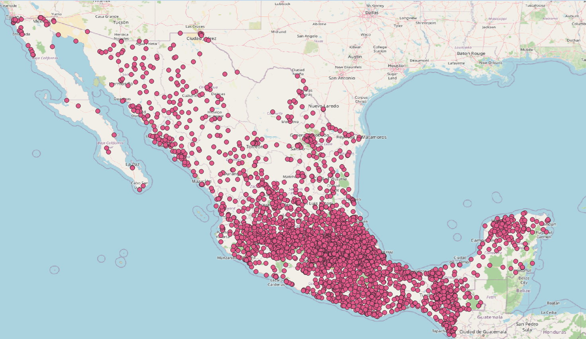

# Sucursales Banco del Bienestar

Scripts en Python que descargan el [directorio público de sucursales del Banco del Bienestar](https://directoriodesucursales.bancodelbienestar.gob.mx/) y lo convierten a **GeoJSON** para usarlo en QGIS u otro SIG.



*Resultado de `salida.geojson` visualizado en QGIS: 3,150 sucursales. Mapa base © colaboradores de [OpenStreetMap](https://www.openstreetmap.org/copyright).*

## Requisitos

- Python 3.10 o superior
- Dependencias: `requests` y `beautifulsoup4`

## Instalación

```powershell
git clone https://github.com/seyler-librado/sucursales-bienestar-geojson.git
cd sucursales-bienestar-geojson

python -m venv .venv
.venv\Scripts\activate          # Windows
# source .venv/bin/activate     # Linux / macOS

pip install -r requirements.txt
```

## Uso

Los scripts se ejecutan en orden. Cada uno usa el archivo que generó el anterior.

```powershell
python municipios.py         # 1. Lista de municipios por entidad
python sucursales.py         # 2. Sucursales y coordenadas por municipio
python convertir_geojson.py  # 3. Conversión a GeoJSON
```

### Flujo de datos

```
data/estados.json               32 entidades con su clave
        │
        ▼  municipios.py
data/listado_municipios.json    municipios por entidad
        │
        ▼  sucursales.py
data/listado_coordenadas.json   sucursales con nombre, domicilio y coordenadas
        │
        ▼  convertir_geojson.py
salida.geojson                  FeatureCollection de puntos
```

### 1. `municipios.py`

Consulta la lista de municipios de cada entidad y la guarda en `data/listado_municipios.json`. Tarda unos 3 minutos. Solo hace falta volver a ejecutarlo si el sitio cambia la lista de municipios.

### 2. `sucursales.py`

Obtiene la página de inicio (para la cookie y el token de verificación) y después busca las sucursales de cada municipio. Las coordenadas se extraen del enlace a Google Maps de cada sucursal.

Es el paso más lento: recorre unos 2,500 municipios con una pausa de 2 segundos entre peticiones, más de una hora en total. Guarda el avance al terminar cada entidad.

Para procesar solo algunas entidades:

```powershell
python sucursales.py "TABASCO" "YUCATAN"
```

> **Nota:** cada ejecución reescribe `data/listado_coordenadas.json` solo con las entidades procesadas.

### 3. `convertir_geojson.py`

Convierte el listado a GeoJSON. Las sucursales sin coordenadas válidas se omiten y se reportan en la consola.

```powershell
python convertir_geojson.py                              # rutas por defecto
python convertir_geojson.py entrada.json salida.geojson  # rutas personalizadas
```

Cada punto incluye estas propiedades:

| Campo       | Descripción                      |
|-------------|----------------------------------|
| `nombre`    | Nombre de la sucursal            |
| `localidad` | Localidad                        |
| `domicilio` | Dirección                        |
| `liga`      | Enlace a Google Maps             |
| `estado`    | Entidad federativa               |
| `municipio` | Municipio o alcaldía             |

Las coordenadas están en WGS 84 (EPSG:4326) y en el orden `[longitud, latitud]` que usa GeoJSON.

## Estructura del proyecto

```
├── config.py              URLs, rutas, headers y funciones compartidas
├── municipios.py          Paso 1
├── sucursales.py          Paso 2
├── convertir_geojson.py   Paso 3
├── requirements.txt
├── LICENSE
├── docs/
│   └── mapa_sucursales.png
└── data/
    ├── estados.json
    ├── listado_municipios.json
    └── listado_coordenadas.json
```

Las URLs, las rutas de los archivos, el tiempo de espera de las peticiones y los headers se configuran en `config.py`.

## Uso responsable

Los scripts hacen pausas entre peticiones (`PAUSA` en cada script) para no saturar el servidor. Se recomienda no reducirlas. La información proviene de un sitio público del Gobierno de México y puede cambiar sin previo aviso.

## Licencia

El código se distribuye bajo la licencia [MIT](LICENSE). Los datos de las sucursales pertenecen a su fuente original, el Banco del Bienestar.
